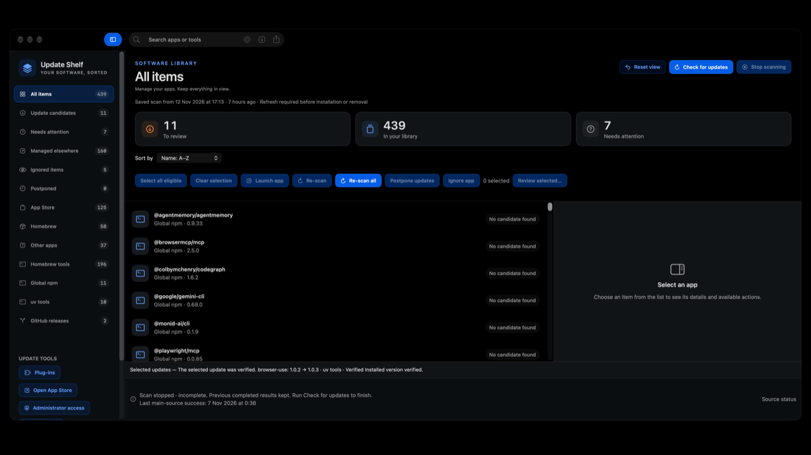

# Update Shelf Releases

## Current stable release

**Update Shelf 0.10.0 (build 156)** for Apple silicon Macs running macOS 14 or later. Free download; [Support development via PayPal](https://www.paypal.com/ncp/payment/VRVYW4BB3CH3L) is optional.

[Download page](https://webservices-org.github.io/update-shelf-releases/) · [Release notes](https://github.com/WEBServices-ORG/update-shelf-releases/releases/tag/v0.10.0-build156)

New in 0.10.0: Stop scanning now sits beside Check for updates. It prevents further checks after the current bounded command finishes, keeps previous completed results, and marks the interrupted scan incomplete. Launch app and Re-scan remain side by side. The older three-card layout and guarded uv pin correction are retained.

Direct updates require a user-owned target and a supported single-app ZIP. DMG/PKG/delta, nested apps and framework-link archives remain external. Recovery keeps the app bundle, not documents or settings, and requires the recorded destination to remain present.

Opening or reopening Update Shelf shows saved results without starting an update check. Manual checks and separately enabled scheduled checks remain available. Saved results cannot authorize installation until refreshed. Broader release QA remains partial.

The app and disk image are Developer ID signed, Apple-notarized and stapled. The in-app update feed offers build156. All four public release files match the verified distribution artifacts; the live download page and feed have been checked.

506 automated tests across 82 suites, independent review, native full-scan stop and restart checks pass. The restored layout and installed build156 were verified on the owner's Mac.

Source coverage varies. App Store updates remain managed by Apple; unsupported app updaters are handoffs, not direct installs. Broader keyboard/VoiceOver, second-Mac/standard-account, natural timer delivery across sleep, and failure/denial coverage remain unfinished. Stable designation does not claim those checks passed.

## App preview

Fresh native 720p screenshot (1280 × 720) of version0.10.0, showing the horizontal scan and app-action controls.

## What the app does

Update Shelf finds supported updates for Mac apps and tools, installs eligible updates after review, and directs you to the responsible app or store for the rest.

- **Check:** Homebrew apps and tools, global npm packages, uv tools, connected GitHub releases, and supported built-in app update sources. Coverage varies; unknown versions stay unknown.
- **Install:** eligible Homebrew, npm, uv and verified stable Sparkle ZIP updates through a reviewed, sequential queue. Direct app updates retain a recovery copy; failure stops the queue. App Store updates remain with Apple; unsupported vendor updates require their own updater or website.
- **Organize:** search, name/size sorting, postponement until tomorrow or next week, ignore-app and skip-version controls.
- **Review outcomes:** searchable, filterable history distinguishes verified changes, failures, and results needing another check. Check again does not install anything.
- **Connect sources:** supported GitHub release checks, identity-bound developer website bookmarks, detection-only cask comparisons and optional Sparkle preview checks. A bookmark alone does not provide automated version checks or installation authority.
- **Choose automation:** separately enabled scheduled checks and a separately enabled automatic tier limited to one eligible Homebrew app per successful cycle. Opening the app never starts an update check.

Not every Mac app or plug-in is covered. An update candidate is not necessarily installable here. Signing/notarization and targeted tests do not mean broader QA is complete.

## Install

[Download Update-Shelf-0.10.0-Apple-Silicon.dmg](https://github.com/WEBServices-ORG/update-shelf-releases/releases/download/v0.10.0-build156/Update-Shelf-0.10.0-Apple-Silicon.dmg), open it, and drag Update Shelf into Applications.

DMG SHA-256: `f1f8c912bcaac8e1f41e8c11f0d466b6bfd32475c8ded6eb23b18a3ea38f069c`

Earlier releases remain historical; the primary download points to0.10.0/build156. See STATE.md for verification status and remaining QA limits.
